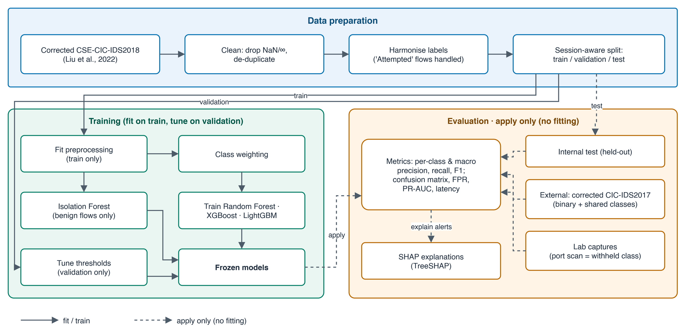
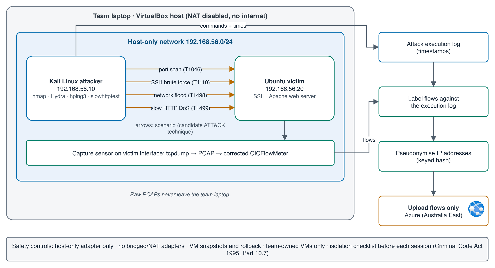

# ExplainIDS: Explainable AI for Cloud-Based Intrusion Detection

An explainable, cross-dataset-validated machine-learning network intrusion detection system (NIDS) with MITRE ATT&CK threat context, delivered as a cloud-hosted dashboard for small and medium businesses.

> Status: in active development (university applied project, Oct–Dec 2026). Design and research are complete; the implementation is being built in sprints.


## Why this project
- **Benchmark scores are often inflated.** Popular IDS datasets (CIC-IDS2017, CSE-CIC-IDS2018) contain documented labelling and flow-construction errors. ExplainIDS trains on the *corrected* releases and tests on a second dataset plus traffic from its own attack lab.
- **Analysts drown in unexplained alerts.** Every alert carries SHAP feature contributions (or an anomaly score), a *candidate* MITRE ATT&CK technique, a severity rating and response guidance for analyst confirmation.
- **Small businesses can't afford a SOC.** The whole stack is open source and runs within free student cloud credit.

## Architecture
| Layer | Tech |
|---|---|
| Data | Corrected CSE-CIC-IDS2018 (train/test), corrected CIC-IDS2017 (external test), isolated Kali → Ubuntu attack lab captured with a corrected CICFlowMeter |
| ML | scikit-learn, XGBoost, LightGBM, Isolation Forest; leakage-controlled evaluation (session-aware splits, preprocessing fitted on train only) |
| Explainability | SHAP (TreeSHAP) |
| Threat analysis | Rule-based candidate MITRE ATT&CK mapping (T1046, T1110, T1498/T1499, T1190), severity and response guidance |
| Serving | FastAPI scoring API, SQLite alert store |
| Dashboard | Streamlit + Plotly |
| Cloud | Docker on Azure (Australia East); GitHub Actions CI |

Design diagrams (editable `.drawio` sources in [`docs/diagrams/`](docs/diagrams/)):

| ML pipeline with leakage controls | Isolated attack lab |
|---|---|
|  |  |

## Evaluation approach
Precision, recall and F1 (per class and macro), confusion matrices, false-positive rate, PR-AUC and latency, reported separately for **internal**, **external (cross-dataset)** and **lab** tests. Accuracy alone is never reported.

## Security, privacy and ethics
- Attack traffic is generated only on team-owned VMs on a host-only network, with no internet route.
- IP addresses are pseudonymised before any cloud upload; raw packet captures never leave the lab machine.
- Aligned with NIST CSF 2.0 (Detect/Respond), ASD Essential Eight hardening and the Australian Privacy Act 1988.

## Repository layout
```
docs/       plan, research (verified sources), diagrams (.drawio + PNG)
src/ids/    data pipeline, models, explainability, threat mapping
api/        FastAPI service
dashboard/  Streamlit dashboard
infra/      Docker and Azure deployment
tests/      pytest
```

## Research
Every source used in the design was checked against its DOI or official page: see [`docs/research/verified_sources.md`](docs/research/verified_sources.md).

## Licence
MIT (see `LICENSE`).
