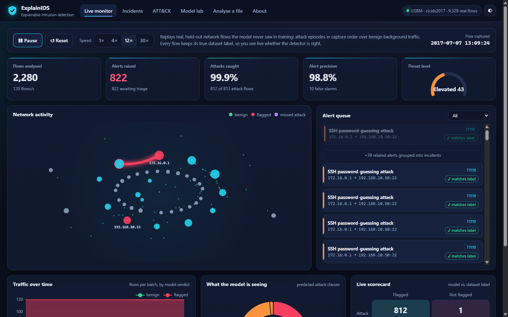
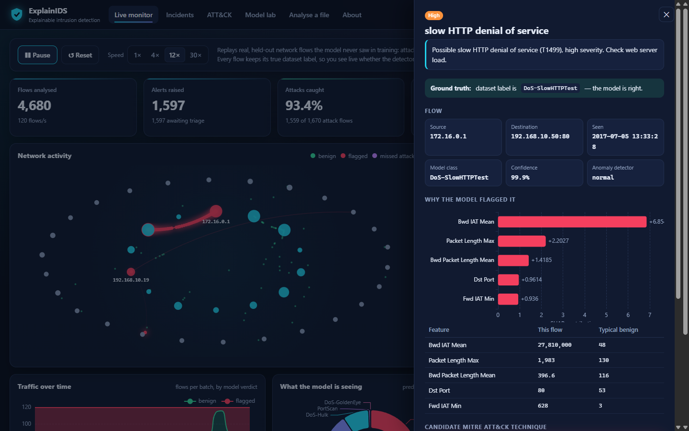
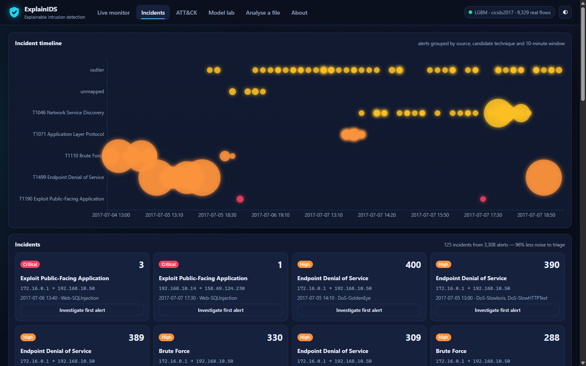
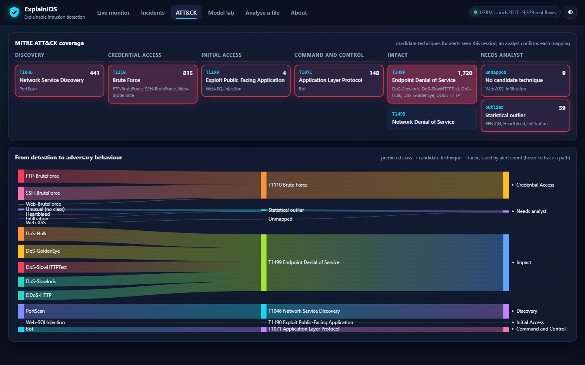
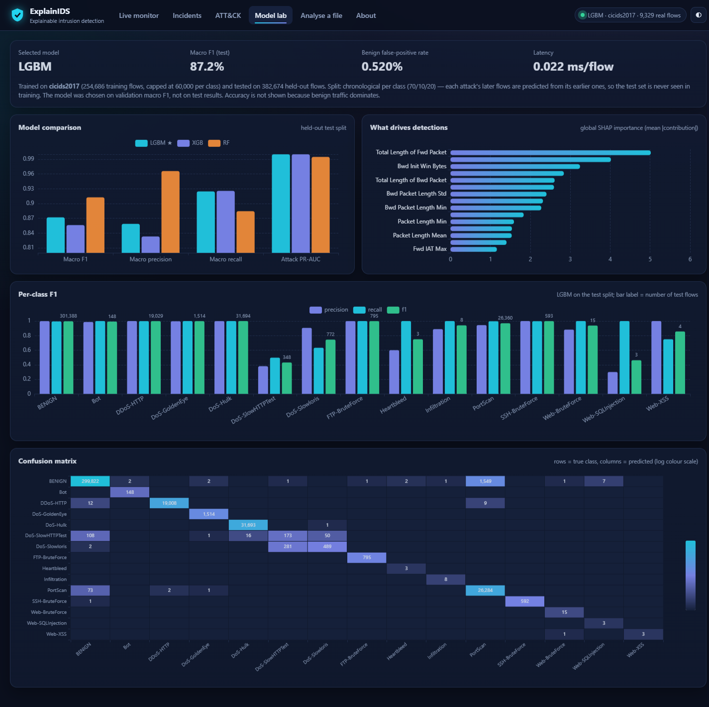
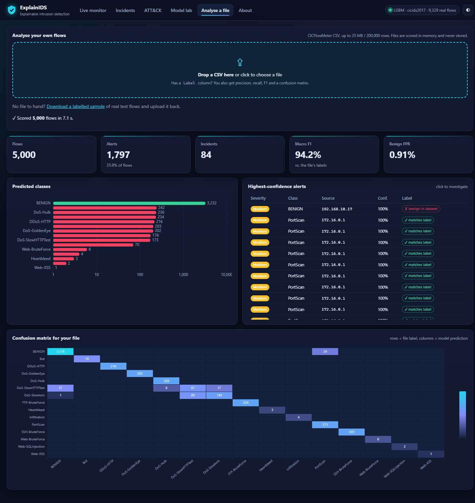
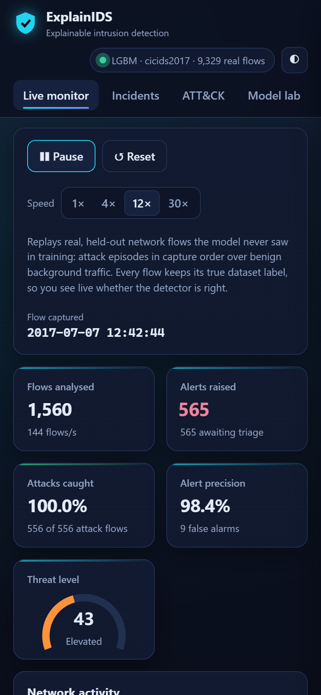
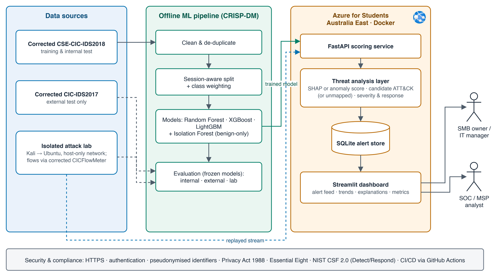

# ExplainIDS: Explainable AI for Cloud-Based Intrusion Detection

An explainable machine-learning network intrusion detection system (NIDS). It scores real network flows, explains every alert with SHAP, maps it to a candidate MITRE ATT&CK technique with response steps, and groups alerts into incidents. It runs as one web app on a laptop, in Docker or in the cloud.



## What you can do with it
- **Watch a live replay of real attack traffic.** Held-out flows from the corrected CIC-IDS2017 release stream through the model in capture order. Each flow keeps its true label, so the console shows hits, misses and false alarms as they happen, not a scripted demo.
- **Investigate any alert.** See which features drove the decision (TreeSHAP), how they compare with typical benign traffic, the candidate ATT&CK technique, the recommended response, and confirm or dismiss it.
- **Cut triage noise.** Alerts are grouped by source, technique and 10-minute window (about 96% fewer items to triage in the replay).
- **See adversary behaviour.** An ATT&CK coverage matrix and a Sankey diagram trace detected class → technique → tactic.
- **Check the model honestly.** The Model lab compares LightGBM, XGBoost and RandomForest on the held-out test split, with per-class F1, a confusion matrix and global SHAP importance.
- **Analyse your own capture.** Upload a CICFlowMeter CSV. If it has labels, you get precision, recall, F1 and a confusion matrix for your own data.

| Investigate an alert | Incidents | ATT&CK mapping |
|---|---|---|
|  |  |  |

| Model lab | Analyse a file | Mobile |
|---|---|---|
|  |  |  |

## Results (corrected CIC-IDS2017, held-out test split)
Chronological split per class (70/10/20): each attack's later flows are predicted from its earlier ones. The model is selected on **validation** macro F1. Full tables are in [`docs/results/cicids2017_baseline.md`](docs/results/cicids2017_baseline.md).

| Model | Test macro precision | Test macro recall | Test macro F1 | Benign false-positive rate | Latency |
|---|---|---|---|---|---|
| **LightGBM (selected)** | 0.859 | 0.925 | 0.872 | 0.52% | 0.023 ms/flow |
| XGBoost | 0.833 | 0.926 | 0.856 | 0.36% | 0.008 ms/flow |
| RandomForest | 0.966 | 0.884 | 0.913 | 0.52% | 0.012 ms/flow |

Where it struggles: **DoS-SlowHTTPTest** (F1 0.43) is confused with Slowloris and benign traffic, and most false alarms are benign flows flagged as PortScan. Cross-dataset testing on corrected CSE-CIC-IDS2018 is in progress. Accuracy is never reported on its own because benign traffic dominates.

## Run it
**Python (3.11+)**
```bash
pip install -e ".[api]"
uvicorn api.main:app --port 8000      # open http://localhost:8000
```
**Docker**
```bash
docker build -t explainids .
docker run -p 8000:8000 explainids
```
Without trained artefacts the app starts in synthetic demo mode. To train on real data, download the corrected datasets from the [CNS2022 release](https://intrusion-detection.distrinet-research.be/CNS2022/) into `data/raw/`, then:
```bash
python scripts/build_processed.py data/raw/cicids2017 data/processed/cicids2017.parquet
python scripts/train_baseline.py data/processed/cicids2017.parquet --models lgbm,xgb,rf --results docs/results/cicids2017_baseline.md
```
The API is documented at `/docs` (OpenAPI). Set `EXPLAINIDS_API_KEY` to require an `X-API-Key` header on the alert endpoints.

## How it works
| Layer | Tech |
|---|---|
| Data | Corrected CIC-IDS2017 and CSE-CIC-IDS2018 (Liu et al., 2022); "Attempted" flows folded into benign as the dataset authors advise |
| Detection | LightGBM / XGBoost / RandomForest with class weighting, plus a benign-only Isolation Forest for unknown traffic |
| Explainability | TreeSHAP per alert, compared with benign medians; global SHAP importance |
| Threat analysis | Candidate MITRE ATT&CK mapping (T1046, T1110, T1190, T1071, T1498/T1499), severity and response guidance, incident aggregation |
| Serving | FastAPI (scoring, replay, upload, alert triage) serving a no-build web console (vanilla JS + ECharts, works offline) |
| Delivery | One Docker image; GitHub Actions CI with tests and a privacy guard |



## Security, privacy and ethics
- Attack traffic is only generated on team-owned VMs on an isolated host-only network. No real networks are scanned.
- Uploaded files are scored in memory and never stored.
- Aligned with NIST CSF 2.0 (Detect/Respond), ASD Essential Eight hardening and the Australian Privacy Act 1988.

## Repository layout
```
api/        FastAPI service (also serves the web console)
web/        web console: index.html, styles.css, app.js, vendored ECharts
src/ids/    data pipeline, models, scoring, explainability, ATT&CK mapping
scripts/    dataset processing, training, download repair
docs/       plan, results, specs, verified research sources, diagrams
tests/      pytest
```

## Data and references
Sharafaldin et al. (2018), [doi:10.5220/0006639801080116](https://doi.org/10.5220/0006639801080116) · Engelen et al. (2021), [doi:10.1109/SPW53761.2021.00009](https://doi.org/10.1109/SPW53761.2021.00009) · Liu et al. (2022), [doi:10.1109/CNS56114.2022.9947235](https://doi.org/10.1109/CNS56114.2022.9947235) · Lundberg et al. (2020), [doi:10.1038/s42256-019-0138-9](https://doi.org/10.1038/s42256-019-0138-9). All sources are checked: [`docs/research/verified_sources.md`](docs/research/verified_sources.md).

## Licence
MIT (see `LICENSE`). ECharts is Apache-2.0.
