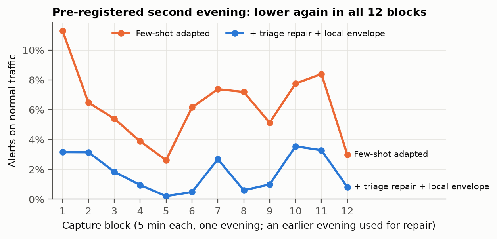
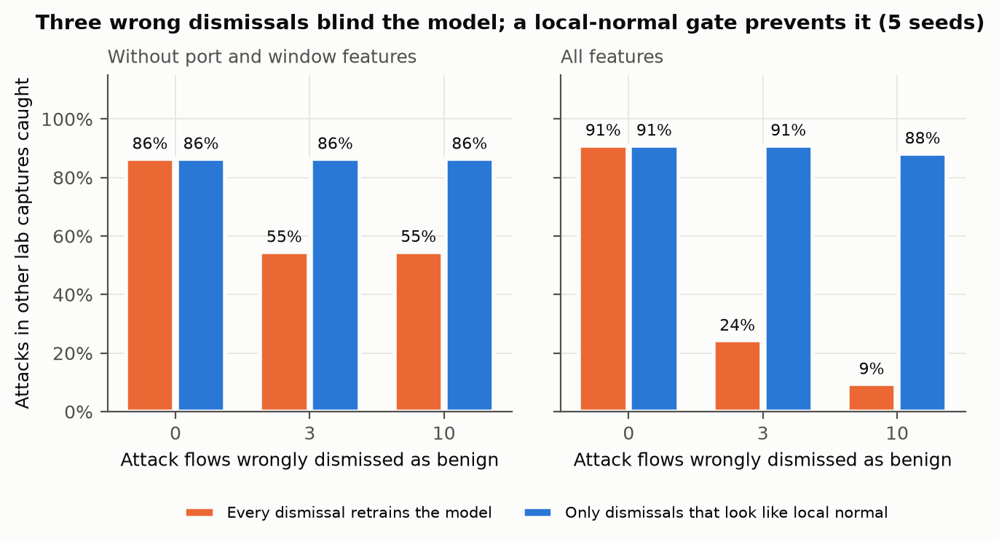

# ExplainIDS research findings

Most published ML intrusion detectors report about 99% on a single benchmark. They are rarely tested on a second network, rarely asked whether their explanations are stable, and rarely tested on attacks missing from training. We asked three questions, each answered by a script in this repository on the corrected CIC-IDS2017 and CSE-CIC-IDS2018 releases (Liu et al., 2022). Every number below comes from the result file linked beside it. The console's **Findings** tab shows the same three answers.

| | Question | Answer | One-line takeaway |
|---|---|---|---|
| **RQ1** | Does a detector trained on one network work on another? | **8%** of attack flows caught after moving 2017 → 2018 (70% the other way) | Near-perfect in-domain scores do not transfer. Local normal traffic restores the false-alarm budget; training on both environments restores detection (0.60 → 0.996). Limited-label adaptation restores detection but degrades legitimate service traffic, and adding about one benign flow per local service (18 flows) removes that regression at no cost to detection, across 10 label seeds. On a real home network, triaged local flows plus a local exemplar envelope cut alerts from 254 to 66 per hour, lower in all 12 blocks, at no detection cost. |
| **RQ2** | Do SHAP explanations stay the same when the model is retrained? | **4 of 5** top features shared per alert (median overlap 0.67); model-wide top-10 overlap 0.82–1.0 | The "why" is stable enough to guide an analyst, but individual ranks are not. |
| **RQ3** | Can it flag an attack type it never saw in training? | **52%** median (2017), 57% with a log-scaled anomaly detector; **7%** on 2018 | Unseen attacks are mostly caught by resembling a known class. The anomaly layer helps scans, not brute force. |

Common setup: data deduplicated globally (no feature vector appears in two splits), then split chronologically per class (70/10/20); training capped at 60,000 flows per class; seed 42; LightGBM unless stated. Metrics follow project rule 4: recall, precision, F1 (macro and per class), benign false-positive rate (FPR) and confusion matrices, never accuracy alone.

---

## RQ1: Generalisation across networks

**Why it matters.** Cross-dataset failure is known (Cantone et al., 2024; Catillo et al., 2022). Verkerken et al. (2022) report Isolation Forest AUROC falling from 0.958 to 0.643 between these two datasets. D'hooge et al. (2022) argue that destination port is a benchmark shortcut that should be removed. We test both claims on the corrected releases with a supervised detector.

**Method.** [`scripts/cross_dataset_eval.py`](../scripts/cross_dataset_eval.py). Train on one dataset's training split and score both datasets' test splits, so in-domain and transfer rows share the same test flows. Macro F1 is averaged over the 12 classes both datasets contain, the same set for every row. A second run drops environment-specific features (destination port, TCP initial window sizes, minimum segment size). Result: [`results/cross_dataset.md`](results/cross_dataset.md).

| Train → test | Attacks caught (recall) | Benign FPR | Macro F1 (12 common classes) |
|---|---|---|---|
| 2017 → 2017 | 99.8% | 0.55% | 0.89 |
| **2017 → 2018** | **8.2%** | 3.02% | 0.58 |
| **2018 → 2017** | **70.3%** | 1.34% | 0.34 |
| 2018 → 2018 | 99.3% | 0.05% | 0.95 |
| 2017 → 2018, portable features | 1.5% | 2.82% | 0.35 |
| 2018 → 2017, portable features | 65.6% | 1.00% | 0.34 |

**What we found.**
- **The collapse is concentrated in two attack tools.** 2017 → 2018 detects 0% of DoS-Hulk and DDoS-HTTP flows, which make up most attack traffic in 2018. Other classes transfer well: SSH brute force 100%, Bot 100%, Web-BruteForce 96%, Web-XSS 96%, DoS-Slowloris 93%.
- **Detection is not attribution.** 2018 → 2017 flags 79% of DoS-Hulk flows but labels almost none correctly (F1 0.00). It calls them other DoS classes, so recall stays high while macro F1 falls.
- **Removing the "shortcut" features made transfer worse, not better** (8.2% → 1.5%). This points to a real difference in how the same tools' traffic looks in each capture, rather than reliance on port numbers. This qualifies D'hooge et al.'s recommendation: dropping metadata features is sound hygiene, but it does not by itself buy generalisation.
- **The model's reasoning shifts with the data.** The global SHAP top-10 for the same model overlaps only 0.82 (2017 model) and 0.67 (2018 model) between its own test set and the other dataset. That is consistent with Layeghy and Portmann (2023).

**Limits.** 2018 benign traffic is a 5% random sample, which makes alert precision optimistic; recall and FPR are unaffected. Two corrected CIC captures share a lab design, so this is a lower bound on how hard a real new network would be.

### Follow-up: can a small business fix this with its own normal traffic?

**Why it matters.** A real site has no labelled attacks, but it can let the detector watch its own normal traffic before alerting. We tested whether that alone recovers the transfer failure.

**Method.** [`scripts/local_calibration_eval.py`](../scripts/local_calibration_eval.py). Take the model trained on one dataset. From the *earliest* part of the other dataset, use only 1,000, 5,000 or 20,000 benign flows (no attack labels), three random samples each. Fit a local anomaly detector on 70% of them and set every threshold on the other 30%, with a 1% false-alarm budget. Score the *later* test period. For speed the test keeps at most 50,000 flows per class, so we quote **class-balanced detection** (the mean of per-class detection), which matches the full-test figure (0.546 vs 0.548). Result: [`results/local_calibration.md`](results/local_calibration.md).

| Rule (2017 model on 2018 traffic) | Class-balanced detection | Benign FPR | False alarms per 10k benign |
|---|---|---|---|
| As deployed (no calibration) | 0.55 | **3.4%** | 344 |
| Local threshold (1,000 local flows) | 0.32 | **1.2%** | 118 |
| Local anomaly detector (1,000 local flows) | **0.61** | 4.4% | 438 |
| Ceiling: model trained on 2018 itself | 0.98 | 0.9% | 91 |

**What we found.**
- **On a new network the false-alarm rate silently triples.** The model was tuned for about 1% false alarms, but it runs at 3.4% on 2018 traffic and 3.1% the other way. Setting the threshold on local benign flows restores the promised rate: 1.0–1.2% for 2017 → 2018 from 1,000 flows; for 2018 → 2017 it falls from 1.7% (1,000 flows) to 1.0% (20,000 flows). For an SME, that is the difference between a workable alert queue and one that gets ignored.
- **But holding the false-alarm budget costs detection.** The model's attack scores do not transfer, so the stricter threshold also drops detection (0.55 → 0.32). Calibration controls alert burden; it cannot create detection the model lacks.
- **A locally refit anomaly detector recovers some attacks.** 2018 → 2017: PortScan 45% → 99%, flow-weighted recall 70% → 88%. 2017 → 2018: DDoS-UDP 0% → 67%. It does so above the budget (2.1–4.4% FPR), because it adds to the classifier's own false alarms.
- **Nothing label-free recovers DoS-Hulk or DDoS-HTTP** (0% before and after, 91% of 2018's attack flows). The classifier confidently calls them normal, and they look normal to an anomaly detector too.
- **More local data steadies the false-alarm rate but does not raise detection** (class-balanced detection is flat from 1,000 to 20,000 flows). The limit is what the model learned, not the size of the calibration sample.

**What this means.** Benign-only calibration is necessary for honest alert budgets on a new site, but not sufficient for detection. Recovering the tools that changed between captures needs either training on more than one environment or a few labelled local examples.

### Follow-up: more environments, or a few labelled local incidents?

**Method.** [`scripts/multi_env_eval.py`](../scripts/multi_env_eval.py) with `--target-only`. Train on one dataset, on both together, or on one dataset plus **k labelled flows per attack type** (k = 10, 50, 200; two label-selection seeds) and 1,000 benign flows from the *earliest* period of the other. A matched **target-only control** trains on exactly the same local annotation budget with the source data removed, so the contribution of the source is measurable rather than assumed. Every model is scored on the later test period of both datasets, on lab traffic, and on **two all-benign service captures** of 330 flows each (200 HTTP, 40 TLS, 30 FTP control, 30 FTP data, 30 successful SSH). Result: [`results/multi_env_matched.md`](results/multi_env_matched.md), 27 conditions with full per-class metrics, supports and confusion matrices.

| Training | 2018 detection | Service profile 1 | Service profile 2 |
|---|---|---|---|
| 2017 only (deployed situation) | 0.598 | 18.2% (60/330) | 9.1% (30/330) |
| **2017 and 2018 together** | **0.996** | **9.1% (30/330)** | **9.1% (30/330)** |
| 2017 + 10 labelled 2018 flows per attack type | 0.943 | 39.4% / 24.2% | 30.3% / 6.1% |
| 2017 + 50 labelled 2018 flows per attack type | 0.982 | 39.4% / 42.7% | 30.3% / 60.6% |
| 2017 + 200 labelled 2018 flows per attack type | 0.991 | 48.5% / 25.8% | 69.7% / 69.4% |
| Target-only control, 50 labels per attack type | 0.980 | 100% (330/330) | 100% (330/330) |

Detection is class-balanced; service columns are benign false-alert rates, one figure per label-selection seed.

**What we found.**
- **Training on both environments is the only condition that improves both axes.** It reaches 0.996 detection on 2018 while *halving* service false alerts, from 18.2% to 9.1%. No limited-label condition matches that.
- **Limited-label adaptation buys detection at the cost of legitimate traffic.** Detection rises with k (0.943 → 0.991), but service false alerts rise too, to between 25.8% and 69.7% at k = 200. The earlier result in [`results/multi_env.md`](results/multi_env.md) measured only attack detection and so recorded the gain without its cost; the detection figures still hold, the conclusion drawn from them does not.
- **The source data is what protects benign behaviour.** Removing it and training on the same local budget reaches 0.980 detection and flags *every* legitimate flow in both profiles at k = 50. This is the control the experiment existed to run.
- **The method is unstable in which labels are drawn.** At k = 10 the second profile gives 30.3% on one seed and 6.1% on the other; at k = 200 the first gives 48.5% against 25.8%. Two seeds show the spread exists; they do not bound it.

**Mechanism.** The errors are structured by service, not scattered. Reading the confusion matrices on the all-benign captures:

| Model | Legitimate flows called an attack |
|---|---|
| 2017 only | 30 → PortScan, 30 → SSH-BruteForce |
| Both environments | 30 → PortScan |
| Few-shot, k = 50 | 98–111 → PortScan, 30 → SSH-BruteForce |
| Target-only, k = 50 | 130 → DoS-Hulk, 100 → Web-XSS, 60 → SSH-BruteForce (one seed) |

The baseline has two specific, interpretable faults: FTP data transfers resemble port scans, and successful SSH sessions resemble SSH brute force. Multi-environment training **removes the SSH fault**, which is the whole of its improvement. Limited-label adaptation instead **amplifies the PortScan fault** from 30 flows to roughly 100, spreading it into HTTP traffic. The target-only control loses class structure on benign traffic altogether.

**What this means.** Where data from more than one environment can be obtained, train on it: the limited-label shortcut is a worse trade than its attack-detection numbers suggest, and local labels alone are unusable for a network that must keep serving its users. This supersedes the earlier "a handful of labelled local incidents closes the gap" conclusion.

**Limits.** Two service profiles, one capture each, on a single topology; the profiles are not independent environments. Labels are oracle class-balanced draws from the target's training period, not the incidents a site would actually accumulate, so the annotation cost is understated. Wilson intervals in the JSON are nominal flow-level intervals and do not account for clustering within a capture. The lab column remains a small deterministic emulation (304 flows, 40 benign).

### Follow-up: can the service regression be repaired?

**Why it matters.** The regression above would stop an SME deploying the adapted model at all: a third
of legitimate SSH, FTP and HTTP flows raising alerts is unusable regardless of attack detection. The
matched run showed the adaptation's benign sample is drawn from the target dataset's training period,
which contains nothing resembling those services, so the model is never shown that they are normal.

**Method.** [`scripts/service_aware_eval.py`](../scripts/service_aware_eval.py). Identical to the
few-shot condition, plus a small number of benign flows taken from one service capture, stratified by
destination port so every service is represented. Those flows are removed from evaluation. Two untrained
populations are scored: the **held-in** remainder of that capture (293 flows), and a **held-out** second
capture in a different service configuration (330 flows, alternate ports) that contributes nothing to
training. Result: [`results/service_aware.md`](results/service_aware.md).

| Training | k | Service flows | Target detection | Held-in false alerts | Held-out false alerts |
|---|---|---|---|---|---|
| Source only | — | — | 0.548 | 18.2% (14.4–22.7) | 9.1% (6.4–12.7) |
| Both environments | — | — | **0.996** | 9.1% (6.4–12.7) | 9.1% (6.4–12.7) |
| Few-shot | 50 | 0 | 0.979 | **41.1%** (34.3–48.1) | **33.6%** (25.0–42.9) |
| **Few-shot + 37 service flows** | 50 | 37 | **0.982** | **0.0%** (0.0–1.3) | **0.0%** (0.0–1.2) |
| Few-shot + 102 service flows | 50 | 102 | 0.981 | 0.0% (0.0–1.7) | 0.0% (0.0–1.2) |

Detection is class-balanced; service columns are benign false-alert rates with 95% Wilson intervals. The service-flow
counts are the flows actually added: the sampler takes at least one flow from every destination port, so the
requested 30 and 100 became 37 and 102 (the result file was first written with the requested figures).

**What we found.**
- **A few dozen benign service flows remove the regression at no cost to detection.** False alerts fall from
  41.1% to zero observed in 293 held-in flows, while target detection rises slightly, 0.979 to 0.982.
  A hundred flows add nothing over 37.
- **The repair transfers to a configuration it never saw.** The held-out capture, using alternate ports,
  falls from 33.6% to zero observed in 330 flows. The model is not memorising the exact flows it was
  given.
- **It beats multi-environment training on this axis.** Training on both datasets leaves 9.1% false
  alerts; 37 local service flows leave none observed. Multi-environment training still wins on raw
  detection, 0.996 against 0.982, so the two remain a genuine choice rather than one dominating.

**Mechanism, by destination port.** The source-only model flags *every* flow on port 22 as
SSH-BruteForce and *every* flow on the passive FTP data ports 30000–30010 as PortScan. Multi-environment
training clears port 22 but not the FTP data ports. Few-shot adaptation at k = 50 keeps both faults and
spreads a new one into **half of all port 80 traffic**. Adding service flows clears every port. The
errors are whole-service failures throughout: a model either flags a service entirely or not at all,
which is why so few examples are enough to correct it.

**How few is enough? Ten label seeds.** [`results/service_aware_seeds.md`](results/service_aware_seeds.md)
repeats the k = 50 condition over 10 label-selection seeds with four repair sizes. The fit profile contains 15
distinct service ports, so the smallest possible stratified repair is one flow per port.

| Service flows added | Target detection, mean (range) | Held-in false alerts, mean (seed range) | Held-out false alerts, pooled over seeds | Seeds with zero held-out false alerts |
|---|---|---|---|---|
| 0 | 0.981 (0.976–0.986) | 38.3% (19.7–42.7) | 1,272 / 3,300 = 38.5% | 0 of 10 |
| 15 (one per port) | 0.982 (0.976–0.987) | 0.0% (0.0–0.0) | 100 / 3,300 = 3.0% | 9 of 10 |
| **18** | **0.982** (0.976–0.986) | 0.1% (0.0–1.0) | **0 / 3,300** (95% upper bound 0.11%) | **10 of 10** |
| 37 | 0.982 (0.978–0.987) | 0.0% (0.0–0.0) | 0 / 3,300 (upper bound 0.11%) | 10 of 10 |

- **The repair is reliable, not lucky.** Without it, every one of the 10 seeds breaks legitimate services
  (held-out rates from 5% to 66%: the regression itself is highly seed-dependent). With 18 flows, none of
  the 3,300 held-out flows alerts on any seed.
- **One flow per service is the threshold, and it is visible when it fails.** At 15 flows, one seed in ten
  calls half of the held-out HTTP traffic on alternate port 8080 *Bot*; three more flows remove it.
- **Detection does not move.** The paired per-seed difference between 37 flows and none is between
  −0.09 and +0.40 points (Wilcoxon p = 0.19).

**What this means.** The deployment recipe is: watch local normal traffic to set an honest alert budget,
seed the model with a few dozen confirmed local incidents per attack type, **and include a couple of
flows of ordinary traffic from every local service**. The third step costs almost nothing and is what makes the
second step safe to use.

**Limits.** Both service captures come from one lab topology on one day; "a different configuration" is
not an independent network. Zero observed false alerts is not zero: the intervals allow up to about 1.3%.
Attack labels remain oracle class-balanced draws, so annotation cost is still understated. Ten label
seeds bound the variance for this pair of captures only. Whether the same per-service budget suffices on a production network with far more service diversity is untested.

### Follow-up: does the repair hold in the other direction?

**Method.** The same design run 2018 → 2017 (k = 50, 5 seeds), plus two additions that the reverse
direction turned out to need. **Triage** chooses the repair flows from what the unrepaired model alerts on in the
fit capture, as an analyst confirming false alarms would, at exactly the same budget as port-stratified
sampling. The **exemplar envelope** ([`src/ids/envelope.py`](../src/ids/envelope.py)) lets a benchmark anomaly
alert stand only if the flow is also far from every known-normal local flow (signed-log features, robust
scaling, leave-one-out nearest-neighbour threshold at a 1% budget). Results:
[`service_aware_reverse`](results/service_aware_reverse.md), [`service_envelope_reverse`](results/service_envelope_reverse.md),
[`service_repair_reverse`](results/service_repair_reverse.md), [`service_repair_forward`](results/service_repair_forward.md).

| 18 local flows, k = 50, 5 seeds | 2017 → 2018: seeds with clean held-in / held-out services | 2018 → 2017: seeds clean held-in / held-out | 2018 → 2017 held-out false alerts, pooled |
|---|---|---|---|
| No repair | 0 / 0 | 0 / 0 | 62.7% |
| Port-stratified flows | 4 / 5 | 0 / 0 | 31.0% |
| Triaged flows | **5 / 5** | 0 / 0 | 43.6% |
| Port-stratified flows + exemplar envelope | 4 / 5 | 4 / 3 | **7.8%** |
| Triaged flows + exemplar envelope | **5 / 5** | **5** / 1 | 19.3% |

**What we found.**
- **In the reverse direction the classifier repair alone fails** (with all 83 features; see the robustness section below, where this turns out to be a fingerprint effect). After it, the classifier makes almost no
  attack calls on legitimate traffic, but the anomaly detector, fitted on 2018's benign traffic, still flags
  about half of all HTTP flows. Two failure mechanisms separate cleanly: service flows fix the classifier,
  and the benchmark's benign envelope needs a local correction.
- **The envelope must be exemplar-based.** An isolation forest fitted on the same local flows cleared
  legitimate traffic on only 3 of 5 seeds: a service seen once or twice still looks isolated to a density
  model. The nearest-normal rule needs one example per behaviour and never lowered target detection by more
  than 0.001.
- **Triage is precise; port coverage generalises.** Triaged flows clean every seed on the services the
  site has seen, in both directions. On a configuration never seen, port-stratified flows generalise better
  (7.8% against 19.3% pooled). The flows that fail are bulk HTTP downloads that port sampling under-represents.

**Limits.** Five seeds; the held-out capture is a second configuration of the same lab, not a new network.

### Live capture pilot: what the detector does on a real network

**Method.** Passive capture on 30 October 2026 (UTC 29 October) through the sensor path: `dumpcap` →
[`scripts/wsl_convert.py`](../scripts/wsl_convert.py) → corrected extractor → strict validation →
[`scripts/score_capture.py`](../scripts/score_capture.py). Two authorised observation points were recorded
simultaneously: a home WiFi network under normal use (household consent obtained), and the internal
switch of an owned Active Directory lab whose guests had just resumed. No attack traffic was generated on
either. With no labels, every alert is a **candidate false alarm for review**. Per-flow traces are kept
privately with keyed host pseudonyms; only aggregates appear here.

| Observation point | Duration actually captured | Usable flows | Unusable (single-packet) | Alerts | Alert rate (95% interval) |
|---|---|---:|---:|---:|---|
| Home WiFi, pilot | 60 s | 51 | 18 | 7 | 13.7% (6.8–25.7) |
| Home WiFi | 52.5 s, stopped at byte cap | 171 | 4 | 18 | 10.5% (6.8–16.0) |
| AD lab switch | 66.3 s, stopped at byte cap | 102 | 2 | 4 | 3.9% (1.5–9.7) |

**What we found.**
- **Real traffic produces alerts the benchmarks never could.** In the pilot, 6 of 7 alerts were SSDP, the
  UPnP discovery traffic every household and office device emits, called *PortScan* at confidence 0.43–0.49
  with `Dst Port = 1900` as a leading SHAP driver. The CIC datasets contain no consumer device-discovery
  traffic.
- **Most WiFi alerts came from the anomaly detector on ordinary downloads.** 12 of the 18 were HTTP or HTTPS
  transfers the classifier itself called benign.
- **The two highest-confidence attack alerts** (*Infiltration*, 1.00 and 0.99) were both long-lived
  connections already open when recording started (first packet within 0.2 s of capture start). That is
  consistent with the extractor orienting a mid-stream flow from its first observed packet; two flows
  support the explanation without proving it.
- **The same traffic receives different verdicts at different observation points.** The lab guests reach
  the internet through NAT that leaves via the WiFi link: 18 of the lab's 19 external servers also appear in
  the WiFi capture, and 42% of WiFi flows go to them. Transfers starting at the same instant to the same
  server were called *BENIGN* (anomaly) on the lab switch and *Heartbleed* (0.53) on WiFi. Oversized
  coalesced packets occur on both interfaces (10% and 37% of flows) and in 25% of CIC-IDS2017 training flows,
  so offload alone does not explain the difference; the mechanism is not established.

**Method findings.**
- **Header-only capture is invalid for this extractor.** Truncating the same capture to 128 bytes per packet
  changed 25 of the 83 features in 113 of 175 flows: the extractor sizes packets from captured, not wire,
  length. Captures must keep full packets, so the byte bound, not the time bound, limits session length on a
  busy link.
- **The two captures are not independent environments.** The lab capture is largely the lab's NAT traffic,
  which the WiFi capture also contains. The host's view of an internal virtual switch also excludes most
  guest-to-guest traffic (no Kerberos or LDAP was visible).

**Limits.** About one minute per observation point, from one evening; these establish that the failure
modes exist on real traffic, not their rates. Alerts are unreviewed candidates.

### Real-network study: does the recipe hold on a network in ordinary use?

**Method.** [`scripts/capture_blocks.py`](../scripts/capture_blocks.py) recorded the same home WiFi network in
12 bounded blocks across one evening (30 October 2026, 12:20–15:12 UTC, 3,307 usable flows, 0.93 h of observed
traffic), with household consent and no traffic generated. [`scripts/real_network_eval.py`](../scripts/real_network_eval.py)
trains each condition and scores every block. Local flows offered to training come only from two sessions
recorded the **previous day** (222 flows), so no evaluated flow, block or day is trained on. The traffic is
unlabelled and no attack was generated, so every alert is counted as a false alert, an upper bound. Each block
is the unit of analysis. Result: [`results/real_network.md`](results/real_network.md).

| Training (5 seeds where seed-dependent) | Target detection | Real-network alerts | Alerts per hour | Blocks lower than few-shot |
|---|---|---|---|---|
| Source only (deployed situation) | 0.548 | 5.7% | 204 | — |
| Both environments | 0.996 | 5.8% | 207 | — |
| Few-shot, k = 50 | 0.980 | 7.2% | 254 | reference |
| Few-shot + 30 **lab** service flows | 0.982 | 7.5% | 266 | 1 of 12 (higher in 11, sign test p = 0.006) |
| Few-shot + 30 local flows (port-spread) | 0.982 | 5.1% | 182 | 12 of 12 (p = 0.0005) |
| Few-shot + 30 triaged local flows | 0.981 | 4.9% | 172 | 12 of 12 (p = 0.0005) |
| **Few-shot + 30 triaged local flows + exemplar envelope** | **0.980** | **1.9%** (seeds 1.5–2.0) | **66** | **12 of 12** (p = 0.0005) |
| Source only + exemplar envelope (no labels at all) | 0.546 | 2.8% | 101 | 12 of 12 vs source only |

**What we found.**
- **The full recipe cuts the alert load by about three-quarters at no cost to detection.** From 254 to 66
  alerts per hour; lower in every one of the 12 blocks; benchmark detection 0.980 in both.
- **A repair built in the lab does not transfer to a real network; it makes things worse.** Lab service flows
  raised alerts in 11 of 12 blocks. The evidence has to come from the site itself.
- **The exemplar envelope does the most work on its own.** With no labels at all it halves the deployed
  model's alerts (5.7% → 2.8%). It removes the anomaly alerts on ordinary HTTPS transfers, which dominate
  the unrepaired models.
- **Real-network failures are service-concentrated but not whole-service.** Alerts gather on HTTPS, NAT-PMP
  (5351), SSDP (1900) and mDNS (5353), but no service is flagged entirely, unlike the lab captures. What remains
  after repair is mostly classifier *Infiltration* and *PortScan* calls on device-discovery protocols the
  previous day's 222 flows barely contained.

**Sensor position: an offload counterfactual.** [`scripts/offload_counterfactual.py`](../scripts/offload_counterfactual.py)
rewrites all 13 WiFi captures with segmentation offload undone and scores both versions with the same frozen
model ([`results/offload_counterfactual_12us.md`](results/offload_counterfactual_12us.md)). Only packetisation
differs. Classifier attack alerts fall from 93 to 74, anomaly-only alerts rise from 115 to 191, and total
alerts rise from 6.0% to 8.1% (51 flows newly alert, 6 clear; McNemar p = 6 × 10⁻¹⁰). Spacing the split
packets 1, 12 or 100 µs apart gives the same result, so it is not a timing artefact of the rewrite. Where a
sensor sits relative to NIC offload systematically changes verdicts, in opposite directions for the two
detector components. The earlier single-capture result (no change in alert volume) did not hold at scale.

**Why the anomaly layer fires.** Over the whole study ([`results/envelope_audit_study.md`](results/envelope_audit_study.md)),
anomaly-only alerts lie outside the benchmark's benign range on 11.5 features on average, against 2.0 for quiet
flows: packet-size maxima and variance, active data packets and bulk volume. Ordinary modern transfers are larger
than anything in the 2017 benign traffic.

**Limits.** One network, one evening, 56 minutes of observed traffic in 12 blocks; one previous day for local
flows. Unlabelled, so alert rates are upper bounds on false alerts and detection is measured only on the
benchmark. Seeds share the same blocks, so per-block sign tests, not flow-level tests, are reported.

### Comparison arms: which flows, and which local model of normal?

**Why it matters.** The literature asks for two comparisons before any novelty claim (see
[RELATED_WORK.md](RELATED_WORK.md)): uncertainty sampling as the usual way to choose which flows an analyst labels
(Vu et al., 2026, preprint), and distribution-level adaptation of the anomaly detector to the site's normal traffic
(Han et al., 2023). Both were added to the real-network study (day 1, shortcut-free features, 5 seeds; result:
[`results/real_network_baselines.md`](results/real_network_baselines.md); Figure 6 in `docs/figures/`).

| 30 local flows chosen by … and anomaly layer | Alerts | Per hour | Detection | Against triage + exemplar envelope (per-block sign test) |
|---|---|---|---|---|
| Triage + exemplar envelope | **2.0%** | 72 | 0.958 | reference |
| Triage + local threshold on the benchmark forest | 2.1% | 73 | 0.958 | no difference (lower 4, higher 2, p = 0.69) |
| Least-confident + exemplar envelope | 2.2% | 78 | 0.957 | no difference (lower 6, higher 5, p = 1.0); seed range 1.7–3.2% vs 1.9–2.2% |
| Triage + local refit (benchmark + local benign) | 3.8% | 135 | 0.959 | envelope lower in 11/12 blocks (p = 0.006) |
| Triage + local isolation-forest veto | 4.7% | 165 | 0.960 | envelope lower in 12/12 (p = 0.0005) |
| Triage, benchmark anomaly layer unchanged | 5.2% | 186 | 0.960 | envelope lower in 12/12 (p = 0.0005) |

**What we found.**
- **What matters on a real network is a local model of the site's normal traffic, set at the site's own alert
  budget.** Re-setting the benchmark anomaly detector's threshold on the previous day's traffic works as well as
  the exemplar envelope here. The exemplar envelope's advantage is over the density-based veto and over refitting the
  detector on pooled benchmark and local traffic, which leaves the benchmark's notion of normal largely in place.
- **How the 30 flows are chosen matters little once the anomaly layer is corrected.** Triage and least-confident
  selection reach the same mean; triage is steadier across seeds. In the lab, triage was the more reliable choice
  (5/5 seeds clean in both directions at 18 flows), so the platform's triage remains the recommended source.
- **Revised claim.** Earlier sections present the exemplar envelope as the anomaly-side repair. The evidence supports
  a narrower statement: either local rule (threshold or exemplar veto) repairs the anomaly layer; the exemplar veto
  is preferable when the benchmark's own threshold must be kept, because it only removes alerts on flows the site has
  seen as normal rather than moving the operating point for all traffic.

**Limits.** One network and one evening; the second, pre-registered evening tests the primary comparison only.

### Pre-registered confirmation: a second evening

**Why it matters.** The recipe was chosen on the first evening, which had been examined. The hypotheses, data and
decision rule for a second, untouched evening were committed before any of its flows were scored
([PREREGISTRATION_DAY2.md](PREREGISTRATION_DAY2.md), commit `1e16194`). Local flows still come only from the first
evening, two days earlier. Day 2: 12/12 blocks validated, 4,634 flows, 0.99 h of observed traffic
([`real_network_day2_portable`](results/real_network_day2_portable.md), [`real_network_day2`](results/real_network_day2.md)).

| Hypothesis (5 seeds, per-block sign test) | Result | Verdict |
|---|---|---|
| H1: triaged flows + exemplar envelope below few-shot, without port and window features | 6.6% → 2.0% (310 → 94 alerts per hour); lower in 12/12 blocks, p = 0.0005 | **Confirmed** |
| H2: detection cost no more than 0.01 | 0.962 → 0.960; mean per-seed change −0.002 (−0.007 to +0.002) | **Confirmed** |
| H3: the same with all 83 features | 6.2% → 1.0% (290 → 46 per hour), 12/12 blocks, p = 0.0005; detection change +0.001 | **Confirmed** |
| H4: 30 lab service flows do not lower alerts | without shortcut features lower 5, higher 6, p = 1.0; with all features higher in 11/12, p = 0.006 | **Confirmed** (neutral, and worse with fingerprint features, as on day 1) |

Tests regenerate with `python scripts/preregistered_tests.py` ([`results/preregistered_day2.md`](results/preregistered_day2.md)).

**Exploratory (not pre-registered), day 2 against triage + exemplar envelope:**
- **Triage beats least-confident selection on the second evening:** lower in 12/12 blocks with either feature set
  (p = 0.0005; 2.0% vs 4.3% without shortcut features). On day 1 the two were indistinguishable, so the claim is
  that triage is never worse and sometimes much better, consistent with the lab result.
- **The anomaly-side variants do not separate on day 2.** Local threshold, local refit and the forest veto are all
  within 0.3 points of the exemplar envelope (sign tests p ≥ 0.11). On day 1 refit and the forest veto were worse.
  The ranking among local models of normal is not stable across evenings; that a local model of normal is needed is.



**What this means.** The primary result replicated on untouched data, at the size seen on day 1, with the analysis
fixed in advance. Two cautions remain: one network, and alerts on unlabelled traffic are upper bounds on false alerts.

### Robustness: are these results a port shortcut?

**Why it matters.** Destination port and TCP initial-window features are known shortcuts that encode the capture
environment rather than behaviour (D'hooge et al., 2022). A reader could fairly ask whether "whole-service failure"
is just the model reading port numbers. Every repair experiment was rerun with those four features removed
(`--portable`, 79 features): [`service_repair_forward_portable`](results/service_repair_forward_portable.md),
[`service_repair_reverse_portable`](results/service_repair_reverse_portable.md), [`real_network_portable`](results/real_network_portable.md).

| k = 50, 5 seeds | All 83 features | Without port and window features |
|---|---|---|
| FTP data transfers, unrepaired | whole service called PortScan | **still the whole service** called PortScan, both directions |
| Few-shot service regression, 2017 → 2018 held-in | 34.2% | 7.8% |
| 18 triaged flows, seeds with clean services, 2017 → 2018 | 5 / 5 | 5 / 5 |
| 18 triaged flows, seeds clean held-in / held-out, 2018 → 2017 | 0 / 0 without envelope; 5 / 1 with it | **5 / 5 without any envelope** |
| Real network: few-shot → triaged flows + exemplar envelope | 7.2% → 1.9%, 12/12 blocks | **6.9% → 2.0%, 12/12 blocks** (p = 0.0005) |
| Real network: 30 lab service flows vs few-shot | worse in 11/12 blocks | no consistent effect (lower in 5/12) |
| Benchmark detection after the full repair | 0.980 | 0.958 (per-seed change −0.024 to +0.002) |

**What we found.**
- **Whole-service failure is behaviour, not a port shortcut.** With port removed, FTP data transfers still look like
  port scans to the model, as a whole service, in both directions.
- **The shortcut features did two specific things.** Port features carried the few-shot *amplification* into HTTP
  (34% → 8% without them). Window features caused the reverse direction's anomaly-layer failure on HTTP: without
  them, 18 triaged flows clean every seed in both directions with no envelope at all. The earlier reverse-direction
  conclusion, that the lab repair needs the envelope, was a fingerprint effect.
- **On the real network the envelope still does the work.** Without fingerprint features the exemplar envelope still
  cuts alerts by about 70%, so the real-network anomaly problem is traffic volume, as the envelope audit showed, not
  fingerprinting.
- **The lab repair's harm on the real network was also a fingerprint effect.** Without those features it is neutral:
  it neither helps nor hurts. Only local evidence helps.
- **Removing the shortcuts has a price.** Benchmark detection falls about two points (0.980 → 0.958–0.963). On one
  real-network seed the repair cost 2.4 points; the median cost is zero.

**What this means.** The repair recipe does not depend on shortcut features. Removing them makes the mechanisms
cleaner: classifier failures become pure behaviour (FTP data as scans), and the anomaly envelope matters only where
traffic volume genuinely differs, on the real network.

### Security of the repair: does it make the detector easier to fool?

**Why it matters.** A repair that lowers false alerts is only useful if it does not hide attacks or open a way to
poison the detector. The home network was never attacked, so attacks come from places that never touch it: the
benchmark's held-out test and three bounded attack replicates from the isolated lab (port scan, SYN burst, SSH and
FTP brute force, incomplete HTTP probes; 792 flows). Flows are scored independently, so scoring lab attacks with the
detector fitted for the home network is equivalent to injecting them into its traffic. Decision rules were committed
before the first run (`scripts/attack_retention_eval.py`, commit `997f9e5`); three additions made after a one-seed
smoke run are labelled exploratory (commit `55f3a66`). Results:
[`attack_retention_portable`](results/attack_retention_portable.md), [`attack_retention`](results/attack_retention.md);
5 seeds, local model of normal fitted on the first evening, false alerts measured on the second.

| Test (5 seeds) | Without port and window features | All features | Rule |
|---|---|---|---|
| R1 retention: lab attack recall, few-shot → triaged + envelope | 86.4% → 86.4%; benchmark 0.962 → 0.960 | 90.9% → 90.9%; 0.980 → 0.981 | Retained |
| Share of caught attacks that only the anomaly layer catches (lab / benchmark) | 0% / about 0.0004% (1–8 flows per seed) | 0% / about 0.0001% (1 per seed) | — |
| R2 up to 264 lab attacks (7.4%) hidden in the local fit pool | recall 86.4% at every level | 90.9% at every level | No effect |
| R2 attacks wrongly dismissed in triage, 3 / 10 | recall 86.4% → 54.5% / 54.6% | 90.9% → 24.3% / 9.4% | **Large effect** |
| R5 the same, dismissals gated by the local envelope (exploratory) | 86.4% / 86.4% | 90.9% / 88.2% | Restored |
| R3 local normal flows needed (within 0.5 points of 3,307) | 100 (2.5% vs 2.0%); 300 matches | 100 (1.3% vs 1.0%) | 100 flows |
| R4 attacks moved toward nearest local normal: largest envelope-vs-benchmark gap | 0.0 points | 0.0 points | No new evasion path |



**What we found.**
- **The local model of normal costs almost nothing on known attacks, and the reason matters.** For attack classes
  the model was trained on, the classifier makes nearly every detection: the benchmark anomaly layer adds none in
  the lab and only 1–8 benchmark flows per seed (corrected 8 November after an independent audit; the table had
  rounded them to 0%). Without port and window features the veto removed 12 of these over five runs; with all
  features it kept them. This is also why hiding attacks in the fit pool (R2) leaves lab recall unchanged and the
  evasion stress test (R4) shows no gap.
  The anomaly layer's job is unseen attacks; that case is tested separately below.
- **The triage loop is the attack surface.** Three attack flows wrongly dismissed as benign, one tenth of the repair
  set, cut recall on attacks from the *other* lab captures from 86% to 55% (shortcut-free) and from 91% to 24% (all
  features); ten cut it to 9%. The classifier learns the dismissed attack type as benign, and the effect is
  concentrated on the dismissed types (port scan and SYN burst). Real-network false alerts do not change, so the
  damage is invisible from the alert queue.
- **A local-normal gate prevents it (exploratory).** Admitting a dismissal into the repair set only if the flow
  resembles the site's earlier normal traffic kept every legitimate triaged flow (27 of 27; 20 of 20), rejected every
  dismissed attack at 3, and let 0–2 of 10 through, restoring recall to 86–91% with false alerts unchanged. The only
  loss after gating is SSH brute force (all features, 3 of 5 seeds), consistent with brute-force flows looking like
  ordinary SSH sessions; a gate cannot catch an attack that resembles normal traffic.
- **A site needs little normal traffic.** About 100 flows bring the false-alert rate within 0.5 points of using all
  3,307; 300 match it.
- **Limits.** Lab attacks are five bounded types, and two (FTP brute force, incomplete HTTP probes) are missed by every
  variant, a detection gap of the model rather than of the repair. Feature interpolation in R4 is a geometric stress
  test, not a realisable attack. The gate was then tested on new dismissals under a pre-specified rule (below).

**Unseen attacks: here the veto has a price.** The anomaly layer exists for attacks never seen in training, so the
veto's real cost is measured there. Each attack class was left out of all training in turn, the deployment recipe
rebuilt, and every flow of the class scored (`scripts/unseen_veto_eval.py`, rule committed before running in
`041e8d9`: a cost if the local rule removes more than 10% of the unseen-attack flows that only the anomaly layer
catches; one seed; [`unseen_veto_portable`](results/unseen_veto_portable.md), [`unseen_veto`](results/unseen_veto.md)).

| Of the unseen-attack flows only the anomaly layer catches … | Without port and window features | All features |
|---|---|---|
| Removed by the exemplar envelope | 201 of 617 (32.6%) | 192 of 599 (32.1%) |
| Removed by the local anomaly threshold | 562 of 617 (91.1%) | 452 of 599 (75.5%) |
| Real-network false alerts: benchmark layer → exemplar → threshold | 3.8% → 1.6% → 1.9% | 2.8% → 1.1% → 1.3% |

- **The rule failed for both local rules: the false-alert reduction is bought partly with unseen-attack detection.**
  The anomaly layer catches few unseen attacks to begin with (617 flows across 21 class-split pairs, mostly Bot,
  DoS-Slowloris and Infiltration), but the local veto removes a share of them.
- **The exemplar veto pays far less than a threshold, and this is what separates them.** On false alerts the two tie
  (E9). On unseen attacks the exemplar veto keeps every Bot detection (403 flows), of which the threshold loses 257–350; its
  losses are DoS-Slowloris (186–195 of 186–198), whose slow, long-lived connections resemble the site's own idle
  HTTPS sessions, and Infiltration (6 of 7–8). A threshold moves the operating point for all traffic; the exemplar
  veto removes only alerts that resemble something the site has done before.
- **What an operator should do.** Prefer the exemplar veto, and demote vetoed anomaly alerts to a low-priority log
  rather than discarding them, so slow-connection attacks remain discoverable. Repeated over five seeds below.

**End to end through the console.** The whole loop was then run through the product's own API
(`scripts/repair_loop_check.py`, [`results/repair_loop`](results/repair_loop.md)): stream the first evening through
the sensor endpoint, dismiss its 190 alerts plus 3 lab attacks by mistake, export the repair set, retrain with
`repair_model.py`, and serve the result. The gate used all 190 household dismissals and held back all 3 attacks. On
the second evening alerts fell from 236 to 45 (5.1% → 1.0%), with 93 vetoed flows kept as low priority rather than
dropped; lab attacks from the other captures were still caught at 90.9%, and benchmark attack recall was unchanged
(0.9976). Dismissing caught attacks under the repaired model marks them *held back* at decision time. This uses
the shipped CIC-IDS2017 model without few-shot labels, so the rates are not the study's; it shows the mechanisms
work together in the product.

### Pre-specified confirmations: gate, unseen cost, refit cadence

Three results above rested on thin evidence or had not been tested, so each was fixed in
[`PREREGISTRATION_CONFIRM.md`](PREREGISTRATION_CONFIRM.md) (commit `bcc0ef5`) before running. Every outcome is
reported as it fell, including the clauses that missed.

| Question | Primary result (without port and window features) | All features (secondary) | Verdict under the rule |
|---|---|---|---|
| C1 gate, 3 wrong dismissals (new replicate, seeds 5–9) | clean 86.5%, ungated 76.6%, gated 86.5%; restored in 5/5 seeds; 100% of legitimate dismissals kept | 90.9% → 42.6% → 90.0%; 4/5 | Gate holds; primary **not confirmed** only because poisoning fell 9.9 points (rule: ≥ 10); all features confirmed |
| C1 gate, 10 wrong dismissals | 86.5% → 55.2% → 86.5%; 5/5; 100% kept | 90.9% → 2.2% → 88.3%; 2/5 | Primary **confirmed**; all features not confirmed (SSH brute force leaks) |
| C2 unseen cost, seeds 42 and 1–4 pooled | exemplar removes 939 of 3,200 anomaly-only unseen detections (29.3%); threshold 95.4% | 321 of 2,357 (13.6%); threshold 83.8% | Cost **confirmed** (> 10%); exemplar pays less in **5/5** seeds, both feature sets |
| C3 refit cadence, 3-day-old vs equal-size 2-day-old pool | alerts 2.03% vs 2.11%; old higher in 4 of 12 blocks, p = 0.39 | — | **No decay detected** (weak test: one day apart) |

Results: [`gate_confirm_portable`](results/gate_confirm_portable.md), [`gate_confirm`](results/gate_confirm.md),
[`unseen_veto_portable_seed1`](results/unseen_veto_portable_seed1.md)–[`seed4`](results/unseen_veto_portable_seed4.md),
[`unseen_veto_seed1`](results/unseen_veto_seed1.md)–[`seed4`](results/unseen_veto_seed4.md),
[`cadence_portable`](results/cadence_portable.md).

**What we found.**
- **The gate replicates on fresh dismissals.** Across both dismissal counts and all ten primary seed runs, gated
  recall equals clean recall exactly and no legitimate dismissal is lost; 0–3 of the dismissed attacks pass the gate.
  The primary k = 3 verdict fails on the poisoning clause, not the gate: with this replicate three dismissals
  damaged only one seed badly (86% → 48%) and the others by about 4 points, so the poisoning effect of a handful of
  mistakes is variable, while ten mistakes damage every seed (49–64%).
- **The gate's known hole is confirmed.** With all features the attacks that pass the gate are SSH brute force, and in
  3 of 5 seeds at 10 dismissals the gated model then misses SSH brute force entirely (recall 86–87% against 91%). A
  gate based on resemblance to normal traffic cannot stop a dismissed attack that looks like an ordinary session; an
  operator still needs to review dismissals of authentication traffic.
- **The unseen-attack price is real and has one shape.** In all ten runs the exemplar veto keeps every Bot detection
  (402–403 flows per run), which the threshold loses 64–100% of, and its losses are DoS-Slowloris and Infiltration.
  Where the all-features anomaly layer does not catch Slowloris at all (seeds 1, 3, 4) the exemplar cost falls to
  1–2%, which is why the pooled share is lower there. Real-network false alerts are unchanged across seeds
  (portable: 3.7–4.0% → 1.6–2.0% exemplar, 1.9–2.3% threshold).
- **A site's model of normal did not go stale in three days.** A 222-flow pilot from three days earlier repaired the
  later evening as well as an equal-size pool from two days earlier (2.0–2.3% against 6.6% unrepaired). This bounds
  nothing beyond a few days; a longer gap is needed to set a refit schedule.

## RQ2: Stability of explanations

**Why it matters.** An explanation an analyst acts on should not change just because the model was retrained. Lin and Wang (2025) found top-5 SHAP rankings highly concordant across 100 seeds in credit scoring (Kendall's W = 0.93), but much less so further down the ranking. We test the same idea on network flows.

**Method.** [`scripts/shap_stability_eval.py`](../scripts/shap_stability_eval.py) (drafted by Codex CLI, reviewed). The same 500 test attack flows are explained by five LightGBM models that differ only in training seed (with bagging, so the seed matters). We compare each flow's top-5 SHAP features between models with Jaccard overlap, only when both models predict the same class. Result: [`results/shap_stability_cicids2017.md`](results/shap_stability_cicids2017.md).

| Measure | Result |
|---|---|
| Per-alert top-5 overlap, median (10th percentile) | **0.67** (0.43); 0.67 means 4 of 5 features shared |
| Prediction changed between seeds | 0 of 5,000 flow pairs |
| Most stable classes | PortScan and SSH brute force: median overlap 1.00 |
| Model-wide top-10 overlap / Spearman rank correlation | 0.82–1.00 / 0.87–0.98 |
| Macro F1 / benign FPR across seeds | 0.88–0.91 / 0.54–0.56% |

**What we found.** The explanation an analyst sees is substantially, but not perfectly, repeatable: typically one of the five reasons changes between retrains. Global importance is more stable than per-alert detail, which matches the pattern Lin and Wang (2025) report for less important features. In practice the console should present the top contributors as a group and not over-interpret their order. Following Loecher (2024), stable does not mean correct; it means repeatable model behaviour.

**Side finding.** The bagged models (row and feature subsampling at 0.8) reach macro F1 0.88–0.91, against 0.86 for the baseline configuration. This is a candidate improvement for the deployed model, to be confirmed on validation data before adoption.

## RQ3: Attacks never seen in training

**Why it matters.** "Detects zero-day attacks" is a common claim. Sarhan et al. (2023) used this exact leave-one-attack-out protocol on UNSW-NB15 and report 87–92% average detection of the withheld class.

**Method.** [`scripts/unseen_attack_eval.py`](../scripts/unseen_attack_eval.py). For each attack class, remove it from training and validation, train the classifier plus a benign-only Isolation Forest (threshold set for 1% false alarms on validation benign traffic), then score every flow of that class. A flow counts as caught if the classifier calls it any attack or the Isolation Forest flags it. Results: [`unseen_cicids2017`](results/unseen_cicids2017.md), [`unseen_cicids2017_log`](results/unseen_cicids2017_log.md), [`unseen_csecicids2018`](results/unseen_csecicids2018.md), [`unseen_csecicids2018_log`](results/unseen_csecicids2018_log.md).

| Dataset | Anomaly detector input | Median detection of unseen class | Classes ≥ 90% | Benign FPR |
|---|---|---|---|---|
| 2017 (14 classes) | raw features | 52% | 3 | 1.0–1.6% |
| 2017 | signed-log features | **57%** | 3 | **0.7–1.1%** |
| 2018 (12 classes) | raw features | 7% | 2 | 0.9% |
| 2018 | signed-log features | 4% | 2 | 1.0% |

**What we found.**
- **Unseen attacks are mostly caught by resemblance.** Unseen DDoS is flagged as DoS-Hulk, unseen Slowloris as SlowHTTPTest, unseen XSS as web brute force. These are useful alerts in the right ATT&CK family, but the classifier cannot say "this is new".
- **The anomaly layer barely helped on raw features.** Flow features are extremely skewed: 56 of 83 have skewness above 5 ([EDA notebook](../notebooks/01_eda_cicids2017.ipynb)). So we tested a signed-log transform before the Isolation Forest. On 2017 it lifted unseen **PortScan from 0% to 93%**, raised the median from 52% to 57%, and *lowered* false alarms. It slightly hurt Bot (6% → 1%) and Infiltration (47% → 39%).
- **Brute force and bots stay invisible.** FTP and SSH brute force and Bot remain near 0% on both datasets: individually they look like ordinary short connections. Per-flow features cannot see them; this points to session- or host-level aggregation as future work.
- **The gap to Sarhan et al. is large.** On 2018 the median is only 7%: there, the DoS family transfers internally, but most other classes are missed.

**Limits.** The unseen rate uses every flow of the withheld class, while the "seen" reference in the result files uses that class's test split and the classifier alone, so the two are not a paired comparison. Classes with fewer than 20 flows (e.g. Heartbleed, 11) give very coarse percentages.

---

## How each problem was found and fixed

| Problem | How we found it | What we changed | Effect |
|---|---|---|---|
| Identical flows in training and test (leakage) | Codex CLI code review: 2,891 test flows matched training vectors | Global deduplication before splitting ([`ids.data.dedup_global`](../src/ids/data.py)); vectors seen with two labels dropped | 2017 macro F1 0.872 → 0.862 (the honest figure) |
| Cross-dataset rows averaged over different classes | Codex dashboard review | Macro F1 over one common class set for every row | In-domain and transfer scores are now comparable |
| Anomaly layer blind on skewed features | RQ3 results plus EDA skewness | Optional signed-log input (`Detector(anomaly_log=True)`) | Unseen PortScan 0% → 93% at a lower false-alarm rate |
| Port "shortcut" suspected (D'hooge et al., 2022) | Literature | Portable feature-set ablation | Not the cause here; transfer got worse without these features |
| False-alarm rate drifts on a new network (3.4% vs ~1% intended) | Local-calibration experiment | Threshold set on local benign flows | Promised 1% budget restored (1.0–1.2%; 2018 → 2017 needs ~20,000 flows), at a cost in detection |
| Transfer misses whole attack tools (DoS-Hulk 0%) | Calibration could not recover them | Training on both environments; limited-label adaptation measured against a matched target-only control | Both-environment training: 2018 detection 0.60 → 0.996 with service false alerts halved. Limited labels raise detection but worsen service false alerts; local labels alone flag all legitimate traffic |
| Adaptation raised false alerts on legitimate SSH/FTP/HTTP to 41% | Service-regression profiles in the matched run | Added a few benign local flows per service port (18–37 in total) to the adaptation set | Held-in false alerts 41.1% → 0.0% observed, held-out 33.6% → 0.0% observed, detection 0.979 → 0.982 |
| "0% false alarms" in a 40-flow lab capture | Wilson intervals added to every metric | Intervals and alert burden reported; small captures labelled as pipeline checks | 0/40 shown honestly as up to 876 false alarms per 10k benign flows |

## Reproduce
```bash
python scripts/build_processed.py data/raw/cicids2017 data/processed/cicids2017.parquet
python scripts/build_sampled.py data/raw/csecicids2018 data/processed/csecicids2018.parquet --benign-frac 0.05
python scripts/cross_dataset_eval.py data/processed/cicids2017.parquet data/processed/csecicids2018.parquet --results docs/results/cross_dataset.md
python scripts/shap_stability_eval.py data/processed/cicids2017.parquet --seeds 42,1,2,3,4 --results docs/results/shap_stability_cicids2017.md
python scripts/unseen_attack_eval.py data/processed/cicids2017.parquet [--anomaly-log] --results docs/results/unseen_cicids2017.md
python scripts/service_aware_eval.py data/processed/cicids2017.parquet data/processed/csecicids2018.parquet --fit-profile data/lab/<standard>/flows_labelled.csv --held-profile data/lab/<alternate>/flows_labelled.csv
python scripts/local_calibration_eval.py data/processed/cicids2017.parquet data/processed/csecicids2018.parquet --sizes 1000,5000,20000 --seeds 42,1,2
python scripts/multi_env_eval.py data/processed/cicids2017.parquet data/processed/csecicids2018.parquet --lab data/lab/<run>/flows_labelled.csv --shots 10,50,200 --seeds 42,1
python scripts/service_aware_eval.py <2018> <2017> --fit-profile ... --held-profile ... --shots 50 --service-flows 0,10,30 --seeds 42,1,2,3,4 --triage --exemplar-envelope --results docs/results/service_repair_reverse.md
python scripts/capture_blocks.py --interface <npf-id> --converter-argv <json> --blocks 12 --block-seconds 300 --gap-seconds 600 --study data/sensor/study_<date>.json
python scripts/real_network_eval.py <2017> <2018> --lab-profile ... --fit-sessions <previous-day sessions> --study data/sensor/study_<date>.json --results docs/results/real_network.md
python scripts/offload_counterfactual.py <sessions> --spacing-us 12 --results docs/results/offload_counterfactual_12us.md
python scripts/envelope_audit.py <2017> <sessions> --results docs/results/envelope_audit_study.md
python scripts/preregistered_tests.py      # H1–H4 for the pre-registered second evening
python scripts/attack_retention_eval.py <2017> <2018> --lab-runs <3 lab replicates> --fit-sessions <day-1 sessions> --study data/sensor/study_wifi_20261101.json [--portable] --results docs/results/attack_retention.md
python scripts/unseen_veto_eval.py <2017> <2018> --fit-sessions <day-1 sessions> --study data/sensor/study_wifi_20261101.json [--portable] --results docs/results/unseen_veto.md
python scripts/gate_confirm.py <2017> <2018> --lab-runs <replicate B> <A> <C> --fit-sessions <day-1 sessions> --study data/sensor/study_wifi_20261101.json --seeds 5,6,7,8,9 [--portable]   # C1
python scripts/unseen_veto_eval.py ... --seed 1   # C2: seeds 1-4, with and without --portable
python scripts/cadence_eval.py <2017> <2018> --old <29 Oct pilot sessions> --recent <day-1 sessions> --study data/sensor/study_wifi_20261101.json --portable   # C3
python scripts/repair_loop_check.py data/processed/cicids2017.parquet --day1 <day-1 sessions> --day2 <day-2 sessions> --lab-runs <3 lab replicates>
python scripts/make_figures.py             # docs/figures from the result files
python scripts/build_research_summary.py   # refreshes the console's Findings tab
```

## References
Cantone, M., Marrocco, C., & Bria, A. (2024). Machine learning in network intrusion detection: A cross-dataset generalization study. *IEEE Access, 12*, 144489–144508. https://doi.org/10.1109/ACCESS.2024.3472907

Catillo, M., Del Vecchio, A., Pecchia, A., & Villano, U. (2022). Transferability of machine learning models learned from public intrusion detection datasets: The CICIDS2017 case study. *Software Quality Journal, 30*(4), 955–981. https://doi.org/10.1007/s11219-022-09587-0

D'hooge, L., Verkerken, M., Volckaert, B., Wauters, T., & De Turck, F. (2022). Establishing the contaminating effect of metadata feature inclusion in machine-learned network intrusion detection models. In *Detection of Intrusions and Malware, and Vulnerability Assessment* (pp. 23–41). Springer. https://doi.org/10.1007/978-3-031-09484-2_2

Layeghy, S., & Portmann, M. (2023). Explainable cross-domain evaluation of ML-based network intrusion detection systems. *Computers and Electrical Engineering, 108*, Article 108692. https://doi.org/10.1016/j.compeleceng.2023.108692

Lin, L., & Wang, Y. (2025). SHAP stability in credit risk management: A case study in credit card default model. *Risks, 13*(12), Article 238. https://doi.org/10.3390/risks13120238

Liu, L., Engelen, G., Lynar, T., Essam, D., & Joosen, W. (2022). Error prevalence in NIDS datasets: A case study on CIC-IDS-2017 and CSE-CIC-IDS-2018. In *2022 IEEE Conference on Communications and Network Security (CNS)* (pp. 254–262). IEEE. https://doi.org/10.1109/CNS56114.2022.9947235

Loecher, M. (2024). Debiasing SHAP scores in random forests. *AStA Advances in Statistical Analysis, 108*(2), 427–440. https://doi.org/10.1007/s10182-023-00479-7

Sarhan, M., Layeghy, S., Gallagher, M., & Portmann, M. (2023). From zero-shot machine learning to zero-day attack detection. *International Journal of Information Security, 22*(4), 947–959. https://doi.org/10.1007/s10207-023-00676-0

Verkerken, M., D'hooge, L., Wauters, T., Volckaert, B., & De Turck, F. (2022). Towards model generalization for intrusion detection: Unsupervised machine learning techniques. *Journal of Network and Systems Management, 30*(1), Article 12. https://doi.org/10.1007/s10922-021-09615-7
